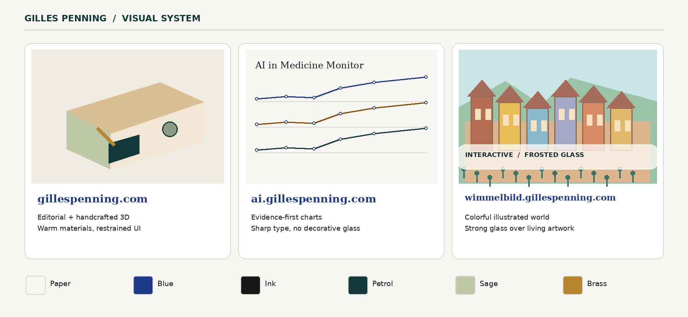
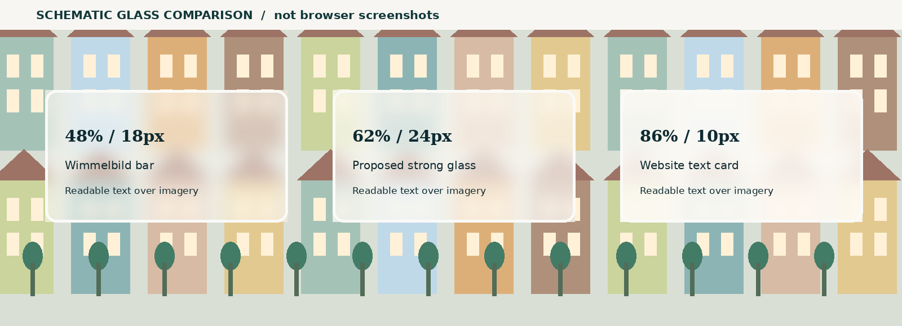

# Gilles Penning - Corporate Identity / Visual Guide

**Visual reading guide.** Left: gillespenning.com uses calm editorial UI around a handcrafted 3D exhibition. Center: the AI in Medicine Monitor prioritizes evidence, charts and readable typography. Right: the Wimmelbild is deliberately colorful, with visibly stronger frosted-glass navigation. These are **schematic design illustrations**, not screenshots of the live websites.

**Glass strength.** The Wimmelbild's observed navigation glass is warmer and more transparent (48% warm white; 18px blur). A proposed stronger expanded-card treatment uses 62% warm white and 24px blur. The portfolio's text-heavy floating cards use approximately 86% warm paper and 8-10px blur. The illustrations explain visual roles; real CSS behavior depends on image and browser.

---

# Gilles Penning - Cross-Project Corporate Identity / Design System
Version: 1.0 | 20 November 2026 | AI-ready specification

## 0. Scope and status
Applies to `gillespenning.com`, `ai.gillespenning.com`, and `wimmelbild.gillespenning.com`, including future webpages, charts, presentations, generated images, editorial graphics and Three.js scenes. This is a **proposed shared design contract derived from the current GitHub code**, not an assertion that all projects already implement every proposed token. Existing assets, layouts, evidence and interactions are not to be replaced automatically.

Source-of-truth repos (default branch `main` as inspected 20 November 2026):
- https://github.com/gilles-pe/gillespenningcom - `DESIGN.md`, `AGENTS.md`, `src/tokens.css`, `src/scene.js`, `src/style.css`
- https://github.com/gilles-pe/ai-in-medicine-monitor - `DESIGN.md`, `styles.css`, `editorial.css`, `monitor.css`
- https://github.com/gilles-pe/medizin-wimmelbild - `AGENTS.md`, `dist/style.css`, `docs/v3_hd_masterplan.md`

## 1. Design intent
**One personality, three experiences.** Academic editorial clarity + warmth of a crafted architectural exhibition + curiosity of a richly illustrated explorable world.

Keywords: **credible, curious, human, precise, tactile, quietly sophisticated**.

Style anchor: *Financial Times / quality journal meets a physical museum exhibit*, not a generic SaaS dashboard or sci-fi AI brand. The primary signature is warm ivory with Prussian blue, serif editorial typography, fine rules and useful details. A material layer of wood, sage, petrol and brass enriches spatial scenes. The Wimmelbild may be **much more colorful and glass-intensive**, because the illustration is the content, not a brand-color patchwork.

### Invariants
1. Information and visual hierarchies lead; styling never obscures content.
2. Flat, calm web design. No arbitrary gradients, neon, fake dashboard glows, fluorescent turquoise, oversized blob shapes, giant emoji, 3D buttons or decorative glass everywhere.
3. Use one strong interactive accent per normal webpage: Prussian blue.
4. Use charts, illustrations, wood/brass materials and subject photography as content-local accent sources, not as competing UI palettes.
5. Transparency is permitted where a background scene needs to remain legible, never as a substitute for contrast.
6. Interfaces are bilingual where already implemented. Never bake interface text into generated artworks.
7. Existing approved marks and project imagery must be preserved unless explicitly changed.

## 2. Shared color architecture
### Core interface colors (exact hex)
| Semantic role | Hex | Intended use |
| --- | --- | --- |
| `paper` | `#F7F6F2` | App/page background, light translucent glass base |
| `surface` | `#FFFFFF` | Card and dialog surface |
| `surface-muted` | `#EEECE5` | Quiet sections and disabled fields |
| `ink` | `#18181B` | All major text |
| `muted` | `#4B5563` | Supporting text and metadata |
| `line` | `#DCD9D0` | Hairline dividers, borders |
| `line-strong` | `#C4C0B5` | More visible outlines |
| `primary` | `#1E3A8A` | Links, active controls, charts, headings as appropriate |
| `primary-strong` | `#172554` | Hover/focus/small text with higher contrast |
| `primary-soft` | `#E8EDF7` | Blue-highlight surface (AI Monitor baseline) |
| `primary-soft-alt` | `#EFF6FF` | Existing homepage highlight, compatibility alias |
| `evidence-gold` | `#8A4B00` | Explicit evidence markers and secondary graphic highlights |
| `evidence-gold-soft` | `#F6EFE2` | Evidential emphasis blocks |

### Material and narrative colors, not second navigation accents
| Role | Hex | Context |
| --- | --- | --- |
| `material-petrol` | `#12383A` | 3D signage, dark green details |
| `wimmel-bg` | `#143844` | Wimmelbild dark environment behind full-bleed artwork |
| `wimmel-ink` | `#0E2A30` | Text on light Wimmel glass |
| `wimmel-muted` | `#3D6468` | Secondary text over pale Wimmel glass, check contrast |
| `material-sage` | `#BFC9A8` | Room walls, illustrations, foliage |
| `material-limestone` | `#F1E7D4` | Architectural model walls |
| `material-oak` | `#D9BF93` | Model furniture and warmth |
| `material-brass` | `#B8862F` | Physical metal in 3D, not generic UI button color |
| `material-satin-glass` | `#E3EFE6` | Architectural glass panels |
| `wimmel-gold` | `#E7B43F` | Rare illustrated location and navigation attention cue |
| `wimmel-gold-focus` | `#FFE08A` | Clear accessibility/focus on dark environment |

Application: 70-85% warm neutral interface surfaces, 10-20% ink/typography/quiet dividers, and typically under 10% primary accent. This is a design guideline, not an image color histogram. **The Wimmelbild itself has no such color limit.**

## 3. Typography
- Primary editorial / prominent headings: `Source Serif 4`, `Georgia`, `serif`. Normal or semibold, no fake outline, usually line-height 1.08-1.25.
- Interface/body/nav/metadata: `Source Sans 3`, `system-ui`, `sans-serif`. Body 16px, line-height ~1.5-1.6.
- Wimmelbild legacy UI: `Inter` is retained for compatibility and clarity on compact, translucent controls; titles remain `Source Serif 4`. For *new* cross-site UI, prefer `Source Sans 3`.
- Shared suggested size vocabulary (px): `12, 14, 16, 20, 28, 40, 64`. Not every project needs every size. Use fluid clamp for display titles only.
- Do not use more than two visible type families in a new asset. Set self-hosted font fallbacks; do not send font files along with this CI.
- Text is sentence case, concise, literal, without tech-marketing buzzwords. Use label spacing conservatively.

## 4. Layout / spacing / radii
- **Base rhythm**: 4px grid. Semantic increments: `4, 8, 12, 16, 20, 24, 32, 40, 48, 64, 104px` - use only those needed in the respective project's local scale.
- **Existing homepage constraint is binding until approved otherwise**: `4, 8, 16, 24, 40, 64, 104px`; its token-check script rejects off-scale values. Do not blindly paste AI Monitor/Wimmel spacing into the homepage.
- **Existing radius implementations:** homepage `0 / 6 / pill`, AI Monitor `6 / 12 / pill`, Wimmelbild `8 / 16 / pill`. This deliberate project-specific difference is better than breaking all existing token checks for cosmetic uniformity.
- **For new shared components, recommended radius family**: small 6px (inputs, buttons), card 12px, immersive glass card 16px, pill 999px, and square 0px for editorial rules. Wimmel's existing small 8px remains until an intentional migration.
- Touch targets at least 44px; 40px is acceptable for visual control height if tap area reaches 44px. No mobile horizontal page scrolling outside explicit galleries, fan menus or plots.
- Borders: usually 1px solid `line`; shadows only for actual elevation. Editorial sections use whitespace and rules before cards/shadows.

## 5. Glass - the intentional three-level system
### A. Editorial - AI Monitor
- **Default: no frosted glass.** Solid `paper` background; `surface` cards; small shadow only where interaction requires layering.
- Data plots, labels, citations and methodological cards remain sharp. Tooltips on near-white opaque panels. Only modal backdrops can be slightly blurred (~3px).

### B. Spatial - gillespenning.com
- Scene controls and small overlays: `rgba(247,246,242,.86)`, blur 8-10px, simple white translucent edge.
- Important intro and preview panels: `rgba(247,246,242,.86-.88)`, blur around 8-10px, dark text.
- Desktop header/footer over the 3D scene: `rgba(247,246,242,.58)`, blur 4px, so the model remains visible.
- Minimal border, 6px radius unless explicitly documented otherwise. Avoid shiny specular highlights or dark nightclub glass.

### C. Immersive / strong glass - Wimmelbild (explicitly permitted)
Preserve the high-color artwork and two permanently visible full-width bars. Stronger glass is welcome where the picture remains perceptible and text reads easily:
- Normal top/bottom bars: `rgba(255,252,247,.48)`, `blur(18px) saturate(1.35)`.
- Normal steps/fan/chips: `rgba(255,252,247,.42)`, `blur(7px) saturate(1.2)`.
- **New proposed stronger-glass variant** for expanded explanation card or overlay: `rgba(255,252,247,.62)`, `blur(24px) saturate(1.35)`, 1px `rgba(255,255,255,.65)` edge. This is a *recommendation*, not a current CSS value. Reserve 0.72 opacity for text-heavy sheets when necessary.
- Active/dark glass: `rgba(16,52,58,.66)`, white text, `blur(18-24px)`.
- Accessibility/no-backdrop fallback: solid or nearly solid paper (`rgba(255,252,247,.96)` or higher). On/off must not move controls or alter the artboard frame.
- Keep a visible hint of what lies behind the glass. Glass is a real optical material, not a pale opaque rectangle with a shadow.
- No more than two overlapping glass layers in the same sightline. With strong glass, increase clarity first by controlling background lightness and readable opacity, not by piling on blur.

### Glass do-not-do
No over-glowing edges, rainbow refractions, excessive saturate, opaque white blur pretending to be glass, white text on light glass, or multi-layer CSS filters on low-performance mobile devices. Backdrop blur should be optional/fallback-safe.

## 6. Image and illustration identity
### General image direction
- Prefer authentic screenshots, real photography and specific documentary evidence to generic stock people.
- Generated editorial imagery: believable subjects and situations, precise anatomy and apparatus, natural daylight, credible object proportions, airy composition, tactile restraint, warm paper/sage/oak palette with precise blue/brass accents. Small imperfections are fine; obvious model artifacts are not.
- Prefer flat editorial drawing, book illustration, photographic realism where appropriate, or handcrafted exhibition miniature. Select one visual language per image series; do not mix a hyper-real face with low-poly plastic healthcare equipment.
- No embedded titles, labels, fake facts, gibberish UI, watermarks or pseudo logos unless exact text is provided for intentional in-image signage.
- Keep quiet negative space when the image must receive real HTML text.

### A. Portfolio / website / talks
- Art-directed, human, natural light. Think photographic journal or a carefully lit architectural scale model.
- Backgrounds can be real Hamburg, objects, rooms, medical technology, artifacts, books, or real work. Avoid glowing brains, hologram hands, circuit-board heads and fake smiley clinicians.
- Website preview/project thumbnails are a family through framing, neutral margins and typography; the content inside can differ.

### B. Wimmelbild / illustrated medicine world
- **Exception to restrained colors**: rich, detailed, colorful, playful, human, inviting, full of distinct microstories and easter eggs. Do not recolor the whole scene navy/teal merely to match website chrome.
- Coherent world geography, architecture, light direction, object sizes, hands and human anatomy. Medical technology looks plausible and recognizable. Maintain location-specific focal points for existing clickable markers.
- Keep image and UI separate: full-bleed art with clean translucent HTML controls. If existing scene is regenerated or cropped, audit *every* hotspot and target coordinate.
- The repo's 3K masterplan describes `3072 × 2060` for a proposed master; current code also contains a 2048 × 1373 source. Do not assert the 3K plan is already deployed. Reuse the actual image aspect ratio and marker mapping.

### C. Three.js rooms / spatial visuals
- Pale limestone walls `#F1E7D4`; oak `#D9BF93`; sage `#BFC9A8`; soft petrol/green base; selective physical brass `#B8862F`; satiny greenish glass `#E3EFE6`.
- Lighting: warm, diffused daylight and soft contact shadows; subtle material roughness, not shiny video-game plastic.
- Design objects as recognizable, well-crafted miniatures: architectural coherence, sparse details visible at practical camera zoom levels, quiet display plinths and frames.
- Preserve existing interactive objects, true source imagery, camera framing and affordances when restyling.

### D. Charts and evidence graphics
- Warm paper, dark ink, blue active series, a small controlled set of secondary series colors where needed, minimal gridlines.
- Legends, axes and evidence distinctions must remain testable, non-deceptive and legible. Do not invent numbers, smooth incomparable benchmarks together, or use an illustration to imply verified patient outcomes.
- Color must never be the sole carrier of meaning: add explicit labels/line styles/symbols.

## 7. UI components
| Element | Design rule |
| --- | --- |
| Page header | Thin divider, editorial brand, compact nav, no oversized floating CTA |
| Primary action | Prussian blue or outlined deep blue; 6px radius on editorial sites |
| Secondary action | Transparent/paper with 1px border; no decorative gradient |
| Card | White or warm paper, subtle rule; 12px typical outside homepage |
| Immersive card | Warm frosted glass, 16px radius on Wimmel, stronger glass allowed |
| Pill/step | Full rounded; not used as default shape for every control |
| Data tooltip | Opaque or nearly opaque white, clear source context, tiny shadow |
| Modal/sheet | Strong enough backdrop for content; keyboard focus, escape, close 44px |
| Divider | 1px `#DCD9D0` rather than a full card border where possible |
| Focus | Visible dark blue on light, warm gold focus ring on dark Wimmel surfaces |
| Icons | Simple coherent vector/stroke, preferably 1.75-2px optical weight, no emojis as system icon |

## 8. Motion
- No motion for motion's sake. Every animation signals navigation, selection, scale, location or cause/effect.
- Ordinary controls: 160-240ms; cards/sheets: 220-350ms; immersive scene and camera moves may be slower.
- The Wimmelbild uses **1100ms** synchronized pan/zoom in its current CSS/JS. Preserve this behavior if touching the code; do not apply 1100ms to buttons.
- Prefer smooth ease-out easing. Never create perpetual shimmer or flashing animations. The Wimmel intro shimmer is one-time.
- Fully honor `prefers-reduced-motion: reduce`. Stop auto movement before accessibility breaks.

## 9. Accessibility / technical contract
- Readability: WCAG AA target for normal text (minimum 4.5:1), 3:1 for large text; test glass *over the actual most varied image area*, not just a flat swatch.
- Preserve keyboard, screenreader, touch and orientation behaviors; focus indicator is explicit.
- Text remains real DOM text on websites. Generated imagery must not contain interface copy.
- Optimize image size (WebP/AVIF with compatible fallback); authored aspect ratio and object fit must be intentional. For Three.js, support static fallback and graceful WebGL failure.
- Prefer existing site's token file and acceptance checks to duplicated values or off-scale CSS.

## 10. Agent instructions - ready to paste
> Act as an art director and front-end designer for the Gilles Penning visual ecosystem. Preserve the identity across three experiences without homogenizing them. Foundation: warm paper `#F7F6F2`, white, ink `#18181B`, primary Prussian blue `#1E3A8A`, thin warm gray rules `#DCD9D0`, editorial `Source Serif 4` headlines and `Source Sans 3` interface text. Design should feel like a credible journal and crafted architectural exhibition, never a shiny generic AI startup. Use restrained 6px editorial buttons, 12px cards and pill shapes selectively. Existing gillespenning.com uses stricter 0/6/full radii and a seven-step spacing system; preserve its checks. 3D rooms can use oak, limestone, sage, petrol and physical brass with soft daylight. AI Monitor is primarily opaque and evidence-first; no broad frosted glass or decorative gradients. Wimmelbild is allowed saturated illustrative color and stronger frosted glass: light 42-48% warm white/18px blur on bars, optional expanded-card 62%/24px blur, dark glass 66%, and contrast/fallback safeguards. Preserve the underlying artwork and hotspot mapping. Do not invent data or hide sources. Use real text rather than image text. Make responsive, touch- and keyboard-accessible, and reduce motion when requested. Reuse current project tokens and preserve approved assets and functionality. Before making changes, explicitly identify any conflicts between the existing code and the proposed shared system.

## 11. Implementation strategy (no blind redesign)
1. Add this master spec as a *reference* in each project's documentation, or keep one canonical copy and link to it. Each repository retains its local source-of-truth CSS tokens.
2. Align terminology, not necessarily exact legacy CSS variable names. E.g. homepage `--teal` and `--petrol` both currently alias the royal blue primary, despite their misleading names; do not casually turn them teal/green.
3. First migrate new components and assets. Change legacy site radii/spacing only with explicit owner approval and acceptance-test changes.
4. Keep Wimmel-specific glass, high-color illustration and interactions. Do not replace the project's bright image with a monochrome corporate version.
5. Review visual consistency on desktop and 320px mobile widths plus contrast over varied artwork. Never declare complete based solely on matching CSS variables.

## 12. Current vs proposed - important distinctions
| Subject | Already observed in GitHub | Proposed CI decision |
| --- | --- | --- |
| Core website/monitor palette | Both use ivory, ink and `#1E3A8A` | Preserve as shared base |
| Typography | All use Source Serif 4, Wimmel sans = Inter, other sites = Source Sans 3 | Keep compatibility; default new work to Serif 4 + Sans 3 |
| Radii | 0/6/full vs 6/12/full vs 8/16/full | Preserve existing; new primitives 6/12/16/full by context |
| Strong glass | Wimmel 42-72% warm white, 18px/7px blur | Optionally add 62%-opacity 24px-strong variant |
| Imagery | Portfolio crafted 3D / Monitor charts / Wimmel vibrant illustration | Keep intentional contrast under one restrained UI identity |
| Logo | Homepage GP/globe mark and Wimmel robot favicon separate | Preserve project-specific icons; align their framing, not their actual design |

## 13. Machine-readable companion
Use `GP_CI_Tokens_2026.json` for semantic values and `GP_CI_Tokens_2026.css` for starter tokens. The CSS starter is **not** a drop-in replacement for any current project's existing stylesheets.
