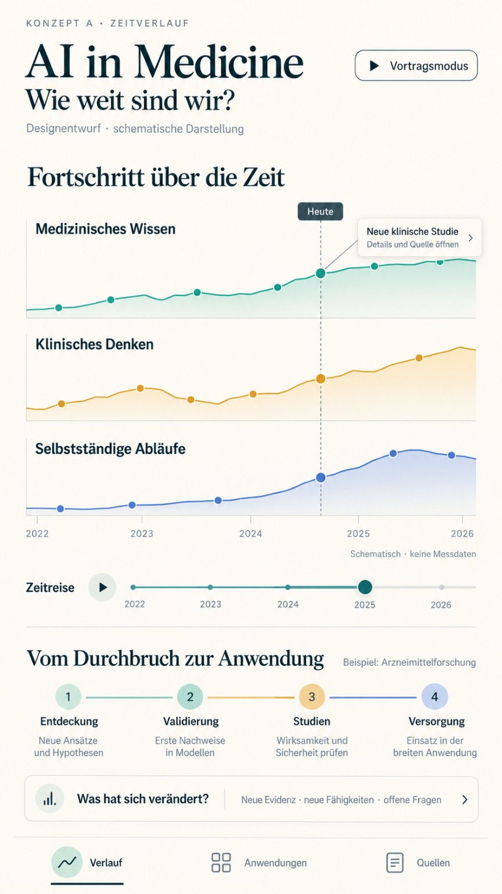

# AI in Medicine Monitor: Variante A

Status: vom Nutzer gewählte visuelle Richtung, Originalbild am 17. Oktober 2026 ergänzt. Dies ist eine Designreferenz; eine Anwendung ist noch nicht umgesetzt.

## Herkunft

Vom Nutzer bereitgestellt als `173056.png`. Die Datei enthält JPEG-Bilddaten mit 864 × 1536 Pixeln. Die Originalbytes wurden unverändert unter `reference-variant-a.jpg` übernommen. Die Dateiendung entspricht hier dem tatsächlichen Format. Der im Bild sichtbare ältere Titel wird in der späteren Oberfläche durch „AI in Medicine Monitor“ ersetzt.

## Sichtbare Gestaltungsmerkmale

- Warmer, heller Hintergrund; dunkles Petrol für Haupttext und Konturen.
- Große Serifenschrift für Titel und Hauptüberschriften; klare serifenlose Beschriftungen.
- Drei übereinanderliegende Diagramme mit gemeinsamer horizontaler Zeitachse.
- Türkis, Gold und Blau unterscheiden die drei Entwicklungsspuren. Transparente Flächen und zurückhaltende Trennlinien ergänzen die Messpunkte.
- Eine senkrechte gestrichelte Zeitmarkierung verbindet die Spuren. Eine Detailkarte zeigt ein ausgewähltes Ereignis mit Quellenzugang.
- Zeitregler mit Abspieltaste unterhalb der Diagramme; separater Vortragsmodus oben.
- Abschnitt zur Entwicklung von Entdeckung über Validierung und Studien bis Versorgung, im Bild am Beispiel Arzneimittelforschung.
- Karte „Was hat sich verändert?“ und untere Navigation mit Verlauf, Anwendungen und Quellen.

Exakte Schriftfamilien, Farbwerte und Abstände sind aus dem Bild noch nicht verbindlich bestimmt. Die schmale Hochformatansicht ist die mobile Referenz; das Layout des Vortragsmodus bleibt offen.

## Zuordnung zur bisherigen Planung

| Bezeichnung im Bild | Zuordnung im Plan | Offene Detailfrage |
| --- | --- | --- |
| Medizinisches Wissen | Wissen und Falllösung, MedXpertQA als Kandidat | Text-/Bildfilter innerhalb der Spur |
| Klinisches Denken | Medizinische Assistenz, HealthBench Professional als Kandidat | Endgültiger Titel, der den gemessenen Aufgabenumfang korrekt beschreibt |
| Selbstständige Abläufe | Eigene Autonomiespur, MedAgentBench als Kandidat | Sichtbares Label für die virtuelle EHR-Testumgebung |

Die Benchmark-Auswahl bleibt ein Vorschlag. Die Vorlage genehmigt keine konkreten Messergebnisse oder zukünftigen Funktionen.

## Fachliche Regeln für die spätere Umsetzung

Die Linien, Flächen und Punkte sind im Original ausdrücklich schematisch. Ihre Höhen, Schwankungen und Jahreswerte werden nicht als Daten übernommen. Echte Ergebnisse brauchen benannte Einheiten, Quellen, Datum und die Vergleichsregeln aus [Datenquellen und Messgrößen](../data-sources.md). Jede Spur erhält eine eigene Skala. Kurven werden nur bei vergleichbaren Messungen verbunden.

„Heute“ und der gewählte Betrachtungszeitpunkt müssen unterscheidbar sein. Im Entwurf liegen Zeitmarkierung und Regler an unterschiedlichen historischen Positionen. Für die Umsetzung werden sie aus dem tatsächlichen bzw. ausgewählten Datum abgeleitet; Messlücken bleiben sichtbar.

Meilensteine erhalten einen eigenen Ereignisbereich. Ein Studienereignis darf nicht den Eindruck erwecken, einen bestimmten Anstieg eines Benchmark-Scores verursacht zu haben. Zukunftsszenarien bleiben von Beobachtungen getrennt.

Die vier Entwicklungsstufen sind eine vereinfachte Erklärung am Beispiel Arzneimittelforschung. Sie gelten nicht als universelle regulatorische Abfolge für jede medizinische KI-Anwendung. Konkrete Ereignisse müssen den tatsächlich belegten Status zeigen.

## Nächster Gestaltungsschritt

Nach Festlegung von Datenumfang und Benchmark-Auswahl: Titel, Spurbeschriftungen, Einheiten und Quellenanzeige in dieser Gestaltungsrichtung konkretisieren. Aufbau und Verhalten von Vortragsmodus, Zeitregler und Änderungsansicht sind anschließend zu spezifizieren.
