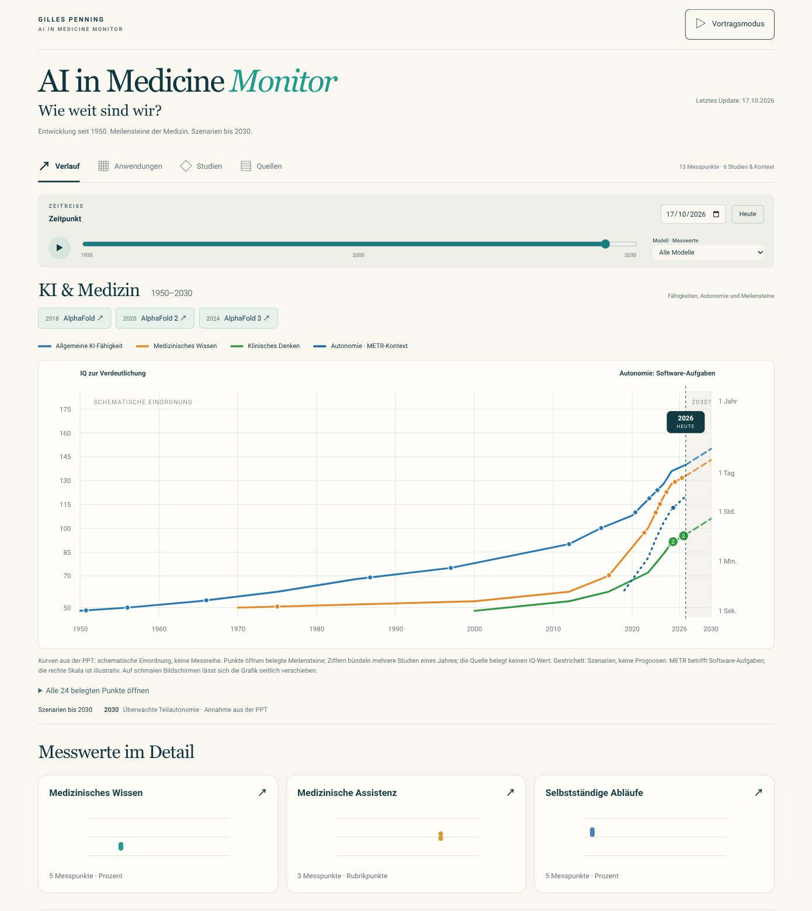

# AI in Medicine Monitor: Umsetzung

Stand: 17. Oktober 2026.

## Auftrag und Ergebnis

Gilles hat die Programmierung und bei Bedarf Subagenten ausdrücklich beauftragt. Dies ersetzt die vorherige Begrenzung auf reine Planung.

Die erste statische Anwendung ist implementiert: drei Messspuren, Datum/Monatsregler, Abspielfunktion, Modellfilter, Quellen- und Detailansicht, Forschungsereignisse, Anwendungsübersicht, Vortragsmodus und gefilterter JSON-Export.

Technische Grundlage sind Browser-ES-Module und CSS ohne Laufzeitpakete, Datenbank oder externe Dienste. Der Build kopiert die Anwendung nach dist/.

## Daten

13 aggregierte historische Ergebnisse aus drei versionierten Originalarbeiten. Die Wissensspur nutzt den vollständigen MedXpertQA-Text-Test; kleinere Stichproben sind ausgeschlossen. Alle Seed-Daten verwenden Publikationsdaten. Pro Spur liegt zunächst eine Ausgabe vor; ein Zeittrend wird daraus nicht abgeleitet.

Quellenprüfung und betrachteter Datenstand sind getrennt. Die Daten aktualisieren sich nicht automatisch und sind noch nicht unabhängig fachlich freigegeben.

## Bestandene Prüfungen

Implementierungs-Commit: 38f3c403a79893a3ba75580db88f9dea3b297afe.

[CI-Prüfung](https://github.com/gilles-pe/ai-in-medicine-monitor/actions/runs/39047376173):

- 12 Node-Tests bestanden.
- Statische Paketierung bestanden.
- 16 Playwright-Prüfungen bestanden, acht jeweils auf Desktop und 390px Mobilbreite.
- Geprüft wurden Startansicht, Quellendialog und Fokus, Datum-/Modellfilter, Ansichtswechsel, Vortragsmodus/Escape, gefilterter JSON-Export und horizontale Überläufe.

Zusätzlich ausgeführt: Syntaxprüfung, 49 Daten-/Logik-Assertions und 13 Integrationsprüfungen im V8-DOM-Shim. Diese ersetzen keine Browserprüfung; die echten Browserprüfungen wurden gesondert in CI ausgeführt.

Der erste CI-Lauf hatte trotz bestandener Tests einen roten Gesamtstatus, weil GitHubs Artefaktspeicherkontingent voll war. Der optionale Berichtupload wurde deshalb auf fehlgeschlagene Prüfungen begrenzt und darf deren Auswertung nicht zusätzlich blockieren. Es wurden keine vorhandenen Artefakte gelöscht und keine Abrechnungs-/Kontoeinstellungen geändert.

Der [korrigierte CI-Lauf](https://github.com/gilles-pe/ai-in-medicine-monitor/actions/runs/39047543934) für Commit fcfdaab246cb305e6eb9deb18e1545455e73e447 ist anschließend vollständig grün abgeschlossen. Der Anwendungscode ist gegenüber dem ersten bestandenen Testlauf unverändert.

## Private Live-Bereitstellung

Am 17. Oktober 2026 ausdrücklich beauftragt und erfolgreich abgeschlossen.

- URL: https://ai-in-medicine-monitor.gillesp.chatgpt.site
- Zugriff: zunächst nur Eigentümer nach Anmeldung.
- Site: appgprj_6ad39d7f6b508191ae06d99968c42699
- Bereitstellung: appgdep_6ad39de047e08191b808ae8f2c6fe7ca
- Gespeicherte Version: appgprj_6ad39d7f6b508191ae06d99968c42699~appgver_802e8700b818819183275f4f0cee30c8
- Veröffentlichter Sites-Quellcommit: 3a35abe347a9917715d393219615e75a222c2875
- Herkunft des Anwendungscodes: GitHub-Commit b4716fa339b9effae017f7b37c8dd86cc91e8a79; alle 26 Textdateien wurden beim Übernehmen anhand ihrer Git-Blob-Hashes geprüft. Die Hosting-Konfiguration kam hinzu.

Das statische Paket wurde lokal erfolgreich gebaut, die Quelle über den Sites-Prozess übertragen und die Bereitstellung mit Status `succeeded` und der oben genannten URL bestätigt. Zugangsdaten sind nicht im Repository gespeichert.

## Verbleibende Grenzen

Die zusätzliche manuelle Vorschau konnte nicht starten: `bwrap: Can't mount proc on /newroot/proc: Operation not permitted`. Dies ist eine Einschränkung der Vorschauumgebung. Es wurde kein Ersatzserver gestartet und keine erfolgreiche visuelle Abnahme behauptet. Die zuvor bestandenen echten Desktop-/Mobil-Interaktionstests bleiben für den unveränderten Anwendungscode gültig. Eine pixelgenaue Abnahme gegen Variante A steht aus.

## Nächste Arbeit

1. Gestaltung manuell gegen Variante A abnehmen, sobald die Vorschau wieder verfügbar ist.
2. Weitere vergleichbare Messstände und klinische Evidenz fachlich kuratieren.
3. Erst nach definiertem Prüf- und Freigabeprozess eine wöchentliche Datenaktualisierung einrichten.

## Pharma-Erweiterung vom 17. Oktober 2026

Die beauftragte Drive-PowerPoint wurde einschließlich relevanter Bildfolien geprüft. Fünf Forschungs-/Kontexteinträge, vier Pharma-Anwendungsansätze und fünf Meilensteine ergänzen den Monitor. Die 13 Benchmark-Messpunkte bleiben unverändert.

[CI für den Anwendungscode](https://github.com/gilles-pe/ai-in-medicine-monitor/actions/runs/39054021747), Commit 4297d7ca170e3a9f83cdbaef399451c414d8dbab: vollständig erfolgreich. 14 Node-Tests, statischer Build und 20 Browserprüfungen auf Desktop und 390px Mobilbreite bestanden. Zusätzliche Abläufe prüfen Themen-/Datumsfilter, Studiendetails, Pharma-Navigation, Studienexport und alle vier Ansichten auf horizontalen Überlauf.

Die manuelle visuelle Abnahme bleibt durch die bereits dokumentierte Vorschau-Berechtigung eingeschränkt. Die Original-PowerPoint wurde nicht verändert. Siehe [Übernahmeprotokoll](pharma-source-review-2026-10-17.md).

## PPT-Hauptgrafik und Header vom 17. Oktober 2026

Nutzerkorrektur umgesetzt: gemeinsame Grafik 1950–2035, vier aus der PPT extrahierte schematische Kurven, sichtbare AlphaFold-Meilensteine, eigene Zukunftsszenarien. Benchmark-Messwerte bleiben getrennt. M-Marke und „Fortschritt mit Quellen“ sind entfernt; die Kopfzeile zeigt „Letztes Update: 17.10.2026“ aus einem gespeicherten Datum.

[CI](https://github.com/gilles-pe/ai-in-medicine-monitor/actions/runs/39056720823) für Commit b03e493aee2c24fe8c680a568cdd13900a423126: erfolgreich, 16 Node-Tests und 22 Desktop-/Mobil-Browserprüfungen sowie statischer Build bestanden.

Die Live-Ansicht wurde zusätzlich über den verbundenen Chrome-Browser tatsächlich angesehen: Desktop und 390×844px, sichtbare AlphaFold-Schaltflächen und Datumszeile, kein horizontaler Seitenüberlauf. Die mobile Grafik öffnet beim ausgewählten Jahr und bleibt bis 1950 verschiebbar. Dies ergänzt die frühere, durch den lokalen Preview-Supervisor begrenzte visuelle Prüfung.

Erfolgreiche private Veröffentlichung: https://ai-in-medicine-monitor.gillesp.chatgpt.site

- Sites-Quellcommit: 170a3884fbe146363db4826cbc73d79f61f2b12d
- Deployment: appgdep_6ad3b9b6e174819183d12a5f92a814db
- Version: appgprj_6ad39d7f6b508191ae06d99968c42699~appgver_f291775800f8819199b1050a318e4096
- [Aktuelle Desktop-Ansicht](design/current-dashboard.png)

Die genaue Abgrenzung von Illustration und Messwerten steht in [Grafikprotokoll](presentation-chart-2026-10-17.md).

## Quellenanker und Begrenzung bis 2030 – 17. Oktober 2026

Die Beschriftung lautet „IQ zur Verdeutlichung“. Die große Grafik enthält 24 belegte Meilensteine an 22 Markern; zwei gleichjährige Paare öffnen eine Auswahl. Alle Marker führen zu Originalquellen. Die Quellen belegen den Meilenstein und dessen Befund, nicht die schematische IQ-Höhe. Unbelegte Zwischenmarker und zukünftige Punktmarker wurden entfernt. Zeithorizont und Bedienelemente enden 2030. Drei anklickbare Vorschaukarten erschließen die unveränderten 13 Benchmark-Messwerte. MIRA wurde als sechster Studien-/Kontexteintrag ergänzt.

[Studien und Hintergrunddaten](studies-and-background.md) dokumentiert Quellen, Befunde, alle Messwerte, schematische Hintergrundpositionen und den wiedergefundenen Ursprung im Gespräch vom 04.08.2026. [TODO](TODO.md) enthält insbesondere gestaltete Hover-Karten je Punkt, Tastatur-/Mobilzugang und weitere Evidenzpflege.

[CI](https://github.com/gilles-pe/ai-in-medicine-monitor/actions/runs/39058316733), Commit c9e5c30db8cb1c664ccc4ef622b19e7821c26330: 18 Node-Tests, Build und 24 Browserprüfungen erfolgreich. Anschließend wurde die Szenariobeschriftung zur Vermeidung einer Überlappung gekürzt und auf Nutzerwunsch „Vorschau wählen und Grafik öffnen“ entfernt (Commits 66d87a86726ebf1a6012e53f3b008f90a7ac8ba7 und 4714a863f9307b4a9e0755e451be2bc7df2bd6b3); 18 Node-Tests und Build erneut erfolgreich. Keine funktionale Änderung nach der Browser-Testserie.

Private Bereitstellung erfolgreich: https://ai-in-medicine-monitor.gillesp.chatgpt.site, Deployment appgdep_6ad3c04f43908191b472e565e36ba970, Quellcommit d9def5c9cd39b06354f2727f0c96536f0899a2b4. Live geprüft: Quellen-Auswahl → MIRA → korrekte Nature-Originalquelle, Vorschau → Messspur, 2030-Grenze und kein horizontaler Seitenüberlauf. Mobil bei 390 × 844: drei bedienbare Vorschauen, aktueller Grafikausschnitt und kein Seitenüberlauf. Desktop-Sichtprüfung einschließlich korrigierter Achsenbeschriftung abgeschlossen; Bildschirmgröße danach zurückgesetzt.

## Redaktionelle Gestaltung und frühere Meilensteine - 18. Oktober 2026

Die obere Grafik, ihre Liniengeometrie und die 24 Quellenanker bleiben unverändert. Die übrige Gestaltung wurde näher an Konzept A ausgerichtet: offene Diagrammspuren, größere Typografie, weniger Kartenflächen, flache Quellen- und Modellverweise. Die untere Datumsachse beginnt 2022. Je Spur sind drei eigenständige Publikationsmeilensteine mit Quelle und Grenzen ergänzt; ihre Ereignismarker haben keine Leistungsordinate und werden nicht zu einer vergleichbaren Wachstumskurve verbunden. Die 13 Benchmark-Messwerte sind unverändert.

Wissen: Flan-PaLM/Med-PaLM (2022), ChatGPT/USMLE-Beispielfragen (2023), MedXpertQA (2025). Denken/Assistenz: Ayers' Antwortvergleich (2023), Gohs Vignetten-RCT (2024), AMIE (2025). Selbstständige Abläufe: STAR im präklinischen Tiermodell (2022), MedAgentBench (2025), MIRA (2026). Die frühe Vertrauensbefragung von Nov et al. (2023) ist separat verlinkt. Präferenz, Vertrauen, Diagnostik, Robotik und EHR-Aufgabenerledigung bleiben getrennte Endpunkte.

[CI](https://github.com/gilles-pe/ai-in-medicine-monitor/actions/runs/39093824923), Commit 37ab63ef089d1b34dcc67c902226729d43a487df: erfolgreich. 21 Node-Tests, Build und 26 Browserprüfungen für Desktop und Mobilansicht. Die neue Prüfung deckt die historischen Quellen, Datumsgrenzen, getrennte Evidenztypen, Tastaturbedienung und den Export ab. Keine zusätzliche manuelle Sichtprüfung: der Browser-Connector ist in dieser Sitzung nicht verfügbar; kein alternativer Vorschau-Server wurde gestartet.

Quellen und Hintergrund: [Studienregister](studies-and-background.md). Offene visuelle Abnahme: [TODO](TODO.md). Die Screenshots weiter oben dokumentieren den vorherigen Stand vom 17.10.2026.

Private Bereitstellung am 18.10.2026 erfolgreich bestätigt: https://ai-in-medicine-monitor.gillesp.chatgpt.site. Deployment: `appgdep_6ad43db87b4c8191b9a4199ee409913d`; Sites-Quellcommit: `277e21e9c330eba2d98bbb6fe286d344c3f487e2`. Bestehender Eigentümerzugang bleibt erhalten. Der native Erfolgsstatus bestätigt die Bereitstellung, ersetzt die noch offene manuelle Sichtprüfung jedoch nicht.

## Compact English release - 18 October 2026

The interface is now a single English page. Tabs, application screens and the methodology control have been removed. Three visible chart previews link to the detailed sections below, with return and next-chart links. Copy is shorter; the overview list is labelled Milestones. Evidence dialogs and source context are in English. Presentation provenance is not displayed or included in exported study metadata; historical source provenance remains in the repository documentation.

The upper overview retains its curves, scale and evidence anchors. Lower benchmark comparisons use scaled horizontal score lines and markers. The connected dated milestone timelines remain separate from quantitative performance. Repeated comparable evaluations are still needed for a genuine benchmark time trend. All 13 scores, 24 overview anchors, nine lower milestones and six studies are preserved.

[CI](https://github.com/gilles-pe/ai-in-medicine-monitor/actions/runs/39104045758), commit f0909f8e3dff5e244085d1ca25a607d5ba38a502: successful. 21 data/logic tests, build and 20 browser checks across desktop/mobile. Checks cover the single-page layout, no tabs or presentation references, source dialogs, preview/back/next jumps, line scaling, filters, keyboard access, playback, export and overflow. Two bounded agents translated scientific text and reviewed layout/navigation. No extra manual browser inspection was available in this session.

Private publication succeeded: https://ai-in-medicine-monitor.gillesp.chatgpt.site. Deployment `appgdep_6ad4672d28088191bda581ca9dedf8d5`, source commit `f4d4fee897a0758f84730000735e75b0b31109ad`. Existing owner-only access was preserved.

## Compact monitor redesign - 18 October 2026

Implementation in progress: Changes beside the introduction, personal text in About, removal of the visible author name, verified contact links, compact full-width overview, controls below it, consistent solid/dotted/scenario styles, chart-specific links and image exports. Bluesky handle remains unverified. Lower curves retain explicit scientific axes rather than inventing longitudinal performance from publication snapshots. Existing benchmark comparisons remain available in compact disclosures; milestone rails are preserved. Validation and publication results will be recorded after completion.

Validation completed for code commit 2e627b81df1dd2068abc3b854962b9c9fcef3c7e: [CI run](https://github.com/gilles-pe/ai-in-medicine-monitor/actions/runs/39106232075) succeeded. 27 Node data/logic tests, build and 28 desktop/mobile browser checks passed. The checks cover source-native curves and publication boundaries, the benchmark-specific physician reference, PNG signature, copied-link cutoff restoration, name removal, timeline placement, keyboard source access and overflow. Eight model-curve values plus one human reference are documented in studies-and-background.md. These are not longitudinal progress estimates. No additional manual visual inspection was available in this session.

Private publication succeeded on 18 October 2026: https://ai-in-medicine-monitor.gillesp.chatgpt.site. Deployment `appgdep_6ad46f98c5648191a98f139639fd6e3c`, Sites source commit `123e1bf709612e19ae07c57b216bd80e92fd2516`, saved version `appgprj_6ad39d7f6b508191ae06d99968c42699~appgver_acf2102f63688191b75a56fe0aec818a`. Existing owner-only access was preserved. The native deployment status is succeeded; the lack of an additional manual visual inspection remains as noted above.

## Portable v1.1 integration - 18 October 2026

The uploaded package is now the authoritative policy/data baseline. AGENTS.md, MONITOR_STANDARD.md, DESIGN.md and VALIDATION_REPORT.md were read before implementation and imported. All 41 source records remain unchanged, including their scores, original validation states and legacy payloads. Previous dashboard data is preserved under extensions.legacyDashboard in the same central JSON; former JavaScript data files are compatibility readers.

Lower charts now use calendar x-axes aligned from January 2022 through the reviewed month. Best eligible scores are recalculated separately per benchmark, with same-month clustering, subdued other models and explicit retrospective marks. Knowledge/assistance remain provisional, without an unverified main line. All agent timeline dates are also labelled provisional. Unverified baselines, ceiling and benchmark-availability claims are suppressed without deleting imported fields. The stale imported meta.reviewNote was corrected from auditSummary, with original note and import checksum retained in the change log.

Point cards expose test, score meaning, setup, status/comparability and original source; missing links are marked not yet checked. Desktop hover, pinned tap/click dialogs and keyboard access use the structured store. Lower chart touch targets are at least 44px. Original overview, controls, studies, milestone rails, filters and exports are retained. Multi-benchmark image exports retain separate panels. A portable ZIP export verifies JSON/document hash consistency; build checks reject stale generated contract sections in all four Markdown files.

The managed preview again failed at the environment boundary: bwrap cannot mount /newroot/proc. No replacement preview server was started. Browser CI and any later live inspection are recorded separately below.

The connected-browser inspection also could not start: the browser connector returned UNAVAILABLE (approval session failed; tool not replayed). No signed-in session or successful manual visual inspection was assumed. Automated browser verification is performed by the existing GitHub workflow.

[CI run 39114476922](https://github.com/gilles-pe/ai-in-medicine-monitor/actions/runs/39114476922), code commit `65186007f6b555eca76acf5aa3f9055e717db62d`: succeeded. 45 Node tests, build and 35 desktop/mobile browser checks passed; the desktop-only hover test was intentionally skipped in the mobile project. Browser checks include all 41 observations, separate eligible frontier series, retrospective publication cutoff, five-part cards, missing-source disclosure, hover-to-source reachability, keyboard access, 44px targets and no page overflow at 320px, central JSON/ZIP checksum identity, and both benchmark bands in autonomy PNG exports. Python's independent ZIP reader also verified archive CRCs and central JSON contents. A direct equality check confirmed that all imported track records remain unchanged. No additional manual visual inspection was available, as documented above.

Private publication succeeded on 18 October 2026: https://ai-in-medicine-monitor.gillesp.chatgpt.site. Deployment `appgdep_6ad48e6aa88c8191b2e1bcf8a872a60d`, Sites source commit `fc2143c22b5a414450ef18979e050d7b43ea66ed`, saved version `appgprj_6ad39d7f6b508191ae06d99968c42699~appgver_7761c7cef4908191a0a7d77ae74ddc0c`. Native status: succeeded. Existing owner-only access remains unchanged.

## Bilingual name and navigation - 18 October 2026

Renamed the displayed product, central metadata, policy titles, image branding, selection export and portable package manifest to Digital Health & AI in Medicine. The existing Site identity, URL and owner-only access are retained. Previous title is recorded in meta.previousTitles and the data change log. Scientific track records, numeric values, source URLs and validation states are unchanged.

Added EN/DE language selection with saved preference and shareable lang query parameter. The central JSON carries German UI/evidence translations; original bibliographic titles, model names and raw records are preserved. Switching language translates dynamically rendered charts, cards, hover previews, date/status labels and menus without resetting the current cutoff/model. The compact hamburger navigation includes Feedback, verified LinkedIn/Substack icon links and Substack articles. Bluesky remains visibly inactive pending the profile URL. Feedback composes a user-controlled email draft to the owner; no message is transmitted by the app. Narrow-screen chart headers use separate metric/best-score rows to avoid long German labels colliding.

Local Node/data-contract checks and builds are completed below; browser verification and native publication are recorded separately after completion. No extra manual browser QA is available in this session.

[CI run 39133567108](https://github.com/gilles-pe/ai-in-medicine-monitor/actions/runs/39133567108), code commit `77bff0835af6f98d544f42fb06676efaa35b929c`: succeeded. 49 Node/data-contract tests and 41 desktop/mobile browser checks passed; the desktop hover test is intentionally skipped on mobile. New checks cover German/English round-trip, saved preference, retained cutoff/model, German source cards, menu/social links, Feedback dialog, keyboard/outside-click dismissal, 44px language controls and no overflow at 320px. Existing chart/source/filter/PNG/ZIP checks remain green. The first outside-menu test clicked a heading physically covered by the open menu; its click target was corrected to a genuinely unobstructed region before the successful run. All 41 imported scientific records still match the original package exactly. A separate XML parser accepted the renamed SVG export, including its escaped ampersand.

Private publication succeeded on 18 October 2026: https://ai-in-medicine-monitor.gillesp.chatgpt.site. Deployment `appgdep_6ad4d0062ae08191abe79e83d4af13f4`, Sites source commit `f00af21d17a0b42bf7f49a0f3223cdcfc40b86aa`, saved version `appgprj_6ad39d7f6b508191ae06d99968c42699~appgver_3c4c9a16ab4881918042c82b2c1b552b`. Native deployment status succeeded. Site display metadata was separately updated successfully to Digital Health & AI in Medicine. URL, identity and owner-only access were preserved.

## Evidence and editorial card update - 18 October 2026

Integrated the 24-record missing-metrics audit into the portable JSON, preserving all 41 original numeric values and archival payloads. Corrected source attribution, dates, model labels and training/prompting conditions. There are 35 confirmed complete records, 1 supplier-reported record and 5 under review; 3 of the latter have source-checked numbers but unresolved commercial-model test setup. 28 scores are eligible for separate benchmark-specific frontiers. HealthBench Core and Professional base-model lines now appear alongside the agent-benchmark lines. Qualified MedQA results, the Clinicians product harness, supplier claims and unresolved results do not join a misleading common curve. Four records without established availability/publication dates stay accessible outside the dated plots.

Migrated all 110 detail cards to the central editorial registry: semantic evidence badge, quantitative/comparative key finding, setup/cohort, concrete limitations/validity and single citation footer. Hover, tap and keyboard share the content; active triggers are highlighted. Corrected AMIE final-paper year and final counts. Added TypeScript interfaces and checked-JavaScript card compilation, plus contract checks and EN/DE content. Updated all policy documents and their generated data hash; exports retain the JSON evidence audit.

[CI run 39150134833](https://github.com/gilles-pe/ai-in-medicine-monitor/actions/runs/39150134833), code commit `a929aadccdc6241ed838215333dad78b16fdfc22`: succeeded. TypeScript check, 53 Node/data tests, build and 43 desktop/mobile Chromium checks passed; 1 desktop-only hover test is intentionally skipped on mobile. Browser coverage includes source cards, active highlight, hover-to-source reachability, keyboard/tap, unpublished/unplaced records, AMIE version separation, German decimal formatting, 320px fit, ZIP integrity and chart image export. Initial failures exposed stale point-count assertions, untranslated decimal formatting and a hover/scroll timing issue; these were corrected before the successful run. No additional manual visual browser inspection was available.

Private publication succeeded: https://ai-in-medicine-monitor.gillesp.chatgpt.site. Deployment `appgdep_6ad5036743ac8191b06633238c85cbec`; source commit `3b104658f34fe33e3212e7cefac4ff747e94fac3`; saved version `appgprj_6ad39d7f6b508191ae06d99968c42699~appgver_4cc78cfb49b881919639bded1aebfb56`. Native deployment status: succeeded. Existing owner-only access remains unchanged.

## Compact AI in Medicine - 18 October 2026

Renamed the visible site, hosting metadata, central title, exports and policy headings to AI in Medicine. Preserved the previous name in the central change log. Each of the three lower tracks now renders one compact SVG canvas; clinical and autonomy benchmarks keep independently derived, labeled lines with different marker/line styling and no cross-benchmark connection. Supporting questions, methods, chronology caveats, unplaced records, legacy result lists, milestone descriptions and export controls sit under one initially closed Details disclosure per track. Milestone markers remain directly accessible, with 44px hit areas and spacing adjusted for touch targets; their year labels retain publication chronology. Source data, validation and all 110 canonical cards are unchanged.

[CI run 39162505218](https://github.com/gilles-pe/ai-in-medicine-monitor/actions/runs/39162505218), code commit `d1864de4540d3d3dc04c165204bfe890c65dda84`: succeeded. TypeScript check, 54 Node tests, build and 45 desktop/mobile browser checks passed; the desktop-only hover case is skipped on mobile. New checks assert exactly one plot per track, closed explanations, compact track heights, both benchmark legends in a single autonomy PNG and continued hover/tap/source access. Initial failures exposed a test selector for a now-clustered point and small milestone hit geometry; the selector was adapted to a real visible result and milestone targets were enlarged. Closing a source dialog also dismisses any restored hover preview. Existing 320px, EN/DE, keyboard, cutoff, selection, source and export checks pass. No additional manual visual browser inspection was available.

Private publication succeeded: https://ai-in-medicine-monitor.gillesp.chatgpt.site. Deployment `appgdep_6ad5296157e08191b32ef8a092a8fb44`; Sites source commit `b15ee7188f983598c54c145aef59cfafa69b4fee`; saved version `appgprj_6ad39d7f6b508191ae06d99968c42699~appgver_bc42e5a0bba88191b8de7b9409d76eb0`. Native status: succeeded. Existing owner-only access and URL are preserved.

## Simplified reading view and 2026 MedQA - 18 October 2026

The site is named Digital Health & AI in Medicine in the header, HTML title, footer, portable JSON and native Sites metadata. Presentation and language controls live in the hamburger menu. Removed chart copy/image tools, return arrows and the nested benchmark/review accordions. Each lower track retains one plot, compact milestone links above it, distinct benchmark colors and a Both/single-series selector. Grouped results share one card with a result switcher. Overview markers are smaller.

Milestones owns the timeline controls. Its disclosure and slider DOM persist through date, slider, model, language and viewport updates; the study disclosure also retains its open state. The reading view shows checked observations only; the portable archive preserves all original records and review flags.

Added three primary-source-checked scores from the June 2026 Nature Medicine study (s41591-026-04431-5): GPT-5.2 94.2%, Claude Opus 4.6 90.2%, Gemini 3.1 Pro Preview 97.4%. Their 500-question, search-enabled MedQA subset has its own series and limitations, independent of historical full-MedQA results. Three lower tracks, six series, 44 retained measurements; 31 scores satisfy frontier eligibility.

Validation: typecheck, 54 unit tests, synchronized documentation and production build passed. GitHub CI run 39165316058 passed 27 desktop/mobile browser cases, with one desktop-only hover case skipped on mobile; covers 320px layout, stable disclosure/slider, benchmark switching, cards, navigation, translation, playback and portable ZIP checksums. A subsequent isolated update corrected the Changes link to medical knowledge and passed the production build. The published page was also inspected in the connected browser, including the menu, smaller overview markers and persistent Milestones during slider interaction; viewport screenshot captured. The stale user tab was reloaded.

Final Sites source f67d3e5b5395e0f7bfbdcf5de45a0f2ea6df5bd5; deployment appgdep_6ad532ba5a008191881dc5da05257b88 succeeded, preserving owner-only access. Original unresolved evidence and chronology limitations remain in VALIDATION_REPORT.md and the portable JSON; no incompatible benchmark lines are joined.

## Production interaction repair - 25 October 2026

Baseline: public GitHub redesign 9dd624f5855b7af9bc6cf775fa12b7dea8130094. The older Sites checkout was not used to overwrite the redesign. Independent read-only agents audited the current functionality/data documentation and the production interaction failure.

Root cause: the production build emitted a literal escaped closing script tag for its deferred app loader. The source-root browser tests passed while the published page never initialized its event handlers. The build now keeps the native module entry point. Browser acceptance waits for an explicit initialized state, fails on uncaught page errors, and serves the exact built artifact under the GitHub project subdirectory. The Pages workflow is gated on desktop/touch tests.

Implemented this run: CSS-pixel overview touch hit testing and grouped selection; source-card click/tap/keyboard behavior; full-view accessible exit labels, 44px controls, focus restoration and keyboard containment; initially closed Glossary/all Sources; persistent user-opened source panels; always-visible practical question with its initially open body below; Still pending masthead and requested tagline; executive/founder wording moved into the profile/image area with truthful monogram alt text. Existing design, charts, news and facts are retained.

Added FUNCTIONALITY.md and docs/data-entry-guide.md. AGENTS links current functionality, design/decisions, root TODO and per-run history. The historical docs/TODO is labelled as such. Portable exports include both authoritative JSON stores and the functionality/backlog/design/history documents. News preview documentation consistently says four items. UI repairs do not claim a new scientific evidence review. The owner portrait and missing AMIE content were tracked explicitly during the initial repair.

Verification and deployment results will be appended after the production checks finish; do not infer release completion from this implementation entry.

Repair verification: f926a6ba2576579d52a498163564c55d1397d194 passed typecheck, 68 unit tests, production build and 123 local-path checks. GitHub Pages run 40140215651 passed 35 production browser cases with three intentional device-specific skips; deployment succeeded. Live gillespenning.com initialized successfully and opened a two-result source card. Tests exercise the built project-subdirectory artifact rather than the source root.

Follow-up in the same run: added the previously authorized AMIE previsit feasibility study as a source, study, clinical milestone and shared card, plus the approved 24 October Bluesky story. Final Lancet abstract checked against the authors' Google Research publication record: 114 enrolled, 98 completed both encounters, 33/44 reviewed cases helpful and 25/44 possible approach change; one hallucination and five supervisor clarifications despite zero safety stops. First-preprint timeline date (9 March) is separate from peer-reviewed publication (8 October). No new benchmark score or cross-protocol trend was introduced; 44 existing scores and their 23 October review date remain unchanged. Exact AMIE LinkedIn/new Substack links remain unverified and absent.

An independent agent fixed the older dynamic German takeaway issue while preserving abbreviation markup, model identifiers, scores and date precision. Root TODO distinguishes completed functional repairs from open portrait, legal copy, metadata, measured contrast and Lighthouse work. Final follow-up release checks and deployment are gated by Pages and recorded below when complete.

The owner supplied a square portrait during this run. Replaced the GP monogram with that original JPEG (no visual modification), updated truthful alt text and cache-busted image URLs in the profile/About page, and completed the portrait TODO. Follow-up local typecheck and 74 unit tests passed; production build and 123 project-path checks passed before release.

Follow-up gate 40140809331 correctly blocked deployment: a study-count fixture still expected six studies, and the extra clinical milestone made the phone assistance section 632px tall. Updated the fixture to seven and kept four milestone controls in one compact row; the 620px acceptance limit is retained. Also replaced the masthead’s page-covering spread shadow with a bounded full-width surface so opening the profile menu keeps the page visible. New keyboard, translation and AMIE browser cases passed in that run; full recheck follows.

A read-only interaction audit caught the bounded masthead surface’s new stacking context: set header z-index 50 above the sticky navigation (40), retaining chart overlay (65/70), hover (80), and native dialog layering. This prevents sticky navigation from intercepting the menu control after scrolling.

Owner corrected the masthead during this run: Gilles Penning, retaining the current ink/teal split, and Tracking what AI can do in medicine. Updated the active functionality/design contract, UI acceptance expectation, TODO and German tagline; historical log entries retain the earlier requested copy.

Final acceptance and publication: source 1fa83e9bd5925f4f9dfa7ab75dd22e9f0e221956 passed 75 unit tests, typecheck, static build and 123 project-subdirectory path checks. Validate dashboard 40141452479 passed 39 desktop/touch browser cases with three intentional device-specific skips. Publish GitHub Pages 40141452498 passed its production-artifact browser gate and deployment. Live https://gillespenning.com/ initialized successfully and showed Gilles Penning, Tracking what AI can do in medicine., the owner portrait URL, and the AMIE previsit milestone. Portrait, interaction, disclosure, documentation/export and translation TODOs are complete. Numerical contrast/Lighthouse certification, legal copy, older news metadata and missing verified AMIE cross-post URLs remain open. This documentation-only follow-up records the verified release; it changes no UI code or data.

Final live viewport check found an 8px horizontal overflow on a desktop with a classic scrollbar. The masthead decorative surface now uses a clipped spread shadow on its pseudo-element instead of 100vw geometry. Menu stacking stays unchanged; the page background remains full width without extending layout. Responsive assertions compare scrollWidth to clientWidth, so scrollbar-width overflows can no longer be hidden by innerWidth. This small layout correction receives the same production gate.

The corrected layout passed production acceptance and Pages deployment in run 40142074570 (source d7930a2). Live HTTP CSS matched the built CSS byte-for-byte, but a previously opened browser retained the old unversioned site.css after reload. The build now references a content-fingerprinted stylesheet filename from both the dashboard and news page, retaining site.css for compatibility. Returning visitors receive the current layout without waiting for their previous CSS cache to expire. No measurement or content changes.

## English/German copy audit - 25 October 2026

Corrected the AI capability question (previously incorrectly I) in the interface, German locale and current contracts. Read dashboard/menu, profile/About, news labels and English/German evidence-card prose. Fixed the fragmentary introduction/profile, awkward invitation, missing German bio and seven shared groups of untranslated caveats; clarified existing diagnostic threshold ≥4/5 and AI assistance direction. Corrected the German mistranslation Rubrikwert/Rubrikpunkte to Bewertungspunktzahl/Bewertungspunkte. News category/language now have a visible separator. Legal-page skip links/placeholder language are consistent; the actual privacy policy remains an open task. An independent read-only agent audited card copy.

75 unit tests, typecheck, production build and 123 path checks passed locally. Verified all canonical card setup/limitation/timeline/finding prose has a German translation; benchmark records, source register and scientific-review date are byte-for-byte unchanged after parsing. No scientific revalidation is claimed. The release uses the existing production desktop/touch gate; publication result is authoritative in GitHub Actions for this commit.

## AMIE cross-post follow-up - 25 October 2026

Reused the existing approved AMIE news, study and clinical graph milestone rather than duplicating the same finding or inventing a benchmark score. Verified the original LinkedIn post in the signed-in profile and its direct public detail view (activity 7519789452114874368); added it alongside the verified Bluesky thread. Corrected originalLanguage to en based on the original English post. Substack returned Site Unavailable twice, so its exact AMIE Note URL remains explicitly open; the older boring-AI article is not substituted as a cross-post. Benchmark records, scientific review dates and existing graph finding (33/44 helpful preparation) remain unchanged. Publisher follow-up question saved separately in Social Post Publisher 0.1.2.

Validation: existing unit/type/build/project-path checks run before commit; Pages workflow gates production publication.

## Compact chronological news and common shell - 25 October 2026

Preserved external main e53f446 before editing. Added native two-line fading disclosures for intro and news, compact right-side original thumbnails, same-family news/chart headings, source/language metadata row and shared header/navigation/menu across all five pages. Removed redundant bottom global source/study and milestone indexes while preserving timeline controls and source cards. Added verified historical posts: 20 distinct stories, 15 original-post thumbnails; research coverage limits are explicit in docs/NEWS_COVERAGE.md and data/news.json. Archive has prerendered full text, canonical URL, RSS, ItemList and chronological grouping. No benchmark measurements changed. Local typecheck, 75 unit tests and 153 path checks passed before release; production desktop/touch gate remains mandatory.

Release f884288d2a21e6fd353f96bfbe4fc85152f74681 passed 75 unit tests, typecheck, build, 154 path checks and 41 production desktop/touch browser cases (three intentional device-specific skips). GitHub Pages run 40179347984 deployed successfully. The first gate correctly blocked an obsolete test targeting the removed global milestone index; the test now opens the same original AlphaFold evidence through its retained chart point. External-browser inventory exposed only a separate empty cloud tab, not the user’s external Substack session; no external-session access is claimed and no substitute login was attempted. Complete Substack/X/LinkedIn coverage remains open. Documentation-only follow-up reconciles superseded disclosure defaults and records this result.

## 25 October 2026 — responsive density and privacy

Adjusted intro defaults, compact image/text fades, title casing, inline chart metrics, smaller Glossary and bilingual privacy notice. Removed standalone Milestones bar and per-chart benchmark filters; retained timeline controls in the menu and both separate benchmark series. Underlying study values and scientific review date unchanged. Local verification: 75 unit tests, TypeScript, build and 156 Pages paths passed. Final runtime source 5ec865c657959cc351e4051d61641498c13dce94 passed 45 desktop/touch production cases (3 intentional device-specific skips), 75 unit tests, TypeScript, build, document contracts and 156 Pages path checks. Publish GitHub Pages run 40181288607 built and deployed successfully.

Follow-up in the same run: moved milestone tiles below each lower plot and its context, immediately before the closed Data table disclosure. Styled native data-table triangles like Sources. Question and answer now have no milestone tiles between them. Added a production interaction/order check.

Release check found a keyboard focus edge case after moving the timeline into the menu: controls inside a closed native disclosure were counted as focusable. The menu/chart focus filter now excludes elements that fail checkVisibility(); desktop/touch release tests are being rerun. The previous build was blocked before deployment (41 browser cases passed, 2 focus cases failed).

The next release run passed 44 browser cases and exposed one desktop zoom edge case: a hover evidence card could cover the full-view exit button after the layout moved under the pointer. Hover cards in expanded charts now reserve the title/control row, keeping the exit button reachable. Deployment remained blocked until the release checks passed.

Final verification: desktop preview confirmed question/answer adjacency, inline heading metrics, native closed Data tables, milestone order and an accessible full-view exit while an evidence hover card was open. Live HTTP verified the removed Milestones bar, menu timeline, removed benchmark selectors, Latest News heading and both privacy languages at gillespenning.com. Scientific measurements and review date are unchanged.

25 October 2026 - latest owner correction: benchmark value sits immediately beside its chart title; review date sits small below the hamburger button. Menu uses About Me, icon-only social links including X, and a bottom row with Feedback left and language right. Presentation controls/behavior, menu News link, timeline playback/date/model controls removed. Historical share URL cutoff remains supported. X profile URL is not verified; its icon currently links to the X homepage. This supersedes earlier timeline/presentation/menu requirements. Release checks pending.

Verified menu release: c9eca7e89cd0fb9ac4542781b360257f5c80dbf8 passed 75 unit tests, TypeScript, build, 152 Pages paths and 41 production desktop/touch cases (3 intentional device-specific skips). Pages run 40200622239 built and deployed successfully. Live HTML confirms the compact header/menu, About Me, X icon and removal of presentation/timeline controls. No evidence values or review dates changed. X homepage remains an explicit fallback pending the owner’s exact profile URL.

25 October 2026 - chart windows and image export: all four charts offer All time / 5Y / 2Y / 1Y / 6M controls below their plots; chosen windows survive full-view and resize. Axes show actual units and adapt with padding to the visible observations; zero remains when appropriate. The overview remains illustrative and all-time retains the 1950–2030 scenarios. Full-view charts offer PNG export with repeated low-contrast ai.gillespenning.com credits rasterized inside the plot, retaining title/date/evidence caveats. Image attribution discourages cropping but is not tamper-proof. News filters removed; owner-confirmed X profile installed. Three authorized Substack Notes are retained in data/news.json coverage.requestedNotes pending verifiable original text/date; see docs/NEWS_COVERAGE.md. No study scores or scientific review date changed. Release checks pending.

Time-window release acceptance: the new 44px touch-target row plus margins adds up to 52px to the existing 620px lower-chart budget (672px total). The first release run passed 42 browser cases, including all eight PNG downloads, and failed only the obsolete mobile height budget (637px). Updated this layout budget explicitly; no interaction or data checks removed.

Release verified: e7bf78e3aeda37691d73f5f5789e4db54115d575 passed 76 unit tests, TypeScript, document contracts, build, 156 Pages path checks and 43 production desktop/touch cases (3 intentional skips). All four chart PNG exports passed on both devices. Pages run 40224865196 built and deployed successfully. Live HTTP checked four range-control groups, adaptive Y bounds, the owner-confirmed X profile and removal of news filters. Three Notes remain pending original content/date verification; no invented news entries were published.

## 25 October 2026 - Microsoft MAI-DxO milestone (owner approved)

Added one Science 2026 source and one Clinical Assistance milestone tile with an editorial card for MAI-DxO stepwise diagnostic reasoning (83.2% on 304 NEJM simulated cases; 36.1% physician comparator measured on 56 cases). Evidence date: 22 October 2026 (journal publication). Science article directly returned HTTP 403 during audit; official Microsoft research account and independent reports corroborated score/DOI, so status is reported and comparability different_protocol. No addition to quantitative benchmark curves, other studies or news. Documentation hash refreshed. Tests/build and publishing remain to be verified prior to release.

## 25 October 2026 - Evidence taxonomy, milestone flag and patient-test distinction

Owner requested visible tags, filters, Data table and Glossary explanations, with reusable agent instructions. Created docs/EVIDENCE_TAGGING.md and required it from AGENTS.md, MONITOR_STANDARD.md, DESIGN.md, FUNCTIONALITY.md and docs/data-entry-guide.md. Added meta.evidenceTaxonomy and all 115 card classifications to data/monitor-data.json, without changing any scores, score validation, model dates or evidence review date. Classifications are provisional unless specifically source-reviewed; this taxonomy labeling must not be mistaken for a second independent scientific validation.

Added shared labels to point cards, milestone tiles, cross-linked AMIE news, Data table setting/design columns and Glossary; topic/setting/major-milestone filters affect milestone tiles only, never benchmark curves. Enabled translations via the existing locale system. Microsoft MAI-DxO is a benchmark-based capability milestone with no actual prospective patient testing; AMIE previsit is a supervised prospective single-arm clinical feasibility study with no demonstrated outcome benefit. Both maintain their original denominators and caveats. Included docs/EVIDENCE_TAGGING.md in portable ZIP and static hosting build.

Automated checks: the initial CI exposed a typecheck issue in newly included translation code; fixed NodeList conversion and DOM element narrowing. The next PR CI run passed TypeScript, unit tests and static build; production browser acceptance and final deployment are tracked by GitHub Actions on PR #3. A source-by-source review of remaining provisional classifications is outstanding.

25 October 2026 - editorial correction after merge: Microsoft MAI-DxO classificationStatus is provisional, not reviewed, because the full original Science Methods were not independently accessible. The capability milestone, original simulated-NEJM case setting, source limitations, numerical results and main-line exclusion remain unchanged. Data checksum synchronized; release checks rerun in PR.

## 25 October 2026 - independent historical source audit and editorial admission rules

User requested a research agent to validate historical evidence and an agent-readable protocol requiring **both** reliable primary evidence and meaningful clinical/scientific impact before any new dashboard entry. Implemented docs/MEASUREMENT_INTAKE.md; linked it from AGENTS.md, MONITOR_STANDARD.md, EVIDENCE_TAGGING.md and docs/data-entry-guide.md. Created a source-grouped audit ledger at docs/HISTORICAL_EVIDENCE_AUDIT_2026-10-25.md. Updated method-classification status only for 11 existing cards from six original publications, retaining scores, score validation statuses, benchmark frontiers and chronology. The 2017 Nature skin-CNN original Methods and curated HealthBench Professional category remain unresolved and are not declared reviewed. New audit and intake files are included in the static build and ZIP.

Sources checked: Goh JAMA 2024 (50 doctors solving vignettes; a randomized study but not a real-patient RCT), AMIE Nature 2025 (patient actors), MIRA Nature 2026 (retrospective EHR sandbox), MedAgentBench arXiv v2 (virtual FHIR tasks), Med-PaLM Nature 2023 (Flan-PaLM score attribution), STAR Science Robotics 2022 (phantom stitches vs supervised pigs). This audit does not imply independent outcome replication. No user-unapproved new scientific data points or milestones were added. The remaining research task is scoped and cannot be considered complete merely because a GitHub issue exists.

## 25 October 2026 - Clinician-chat benchmark taxonomy approval
Owner explicitly approved introducing `clinician_chat_benchmark` and applying it to HealthBench Professional. Added an EN/DE description to `data/monitor-data.json` taxonomy; changed the `testSetting` field for 18 existing Professional/claimed Professional cards (10 chart/system records including vendor/missing-source claims, seven related research/historical/physician cards plus one canonical study). All chart scores, comparability, source validation, classification review status, numerical denominators, timestamps, milestone flags and released model proxies unchanged. The general HealthBench Core 2025 (5,000 broader conversations) is NOT assumed to have the same tasks as HealthBench Professional 2026 (525 clinician-authored tasks with red-team enrichment). The offline benchmark must not be treated as a real-patient clinical trial. Updated `AGENTS.md`, `docs/EVIDENCE_TAGGING.md`, `docs/MEASUREMENT_INTAKE.md`, `MONITOR_STANDARD.md`, data-entry instructions, audit decision, automated validation and tests. UI labels / filters / Data Table / Glossary draw their EN and DE text directly from taxonomy. Build/release verification checked in GitHub CI.

## 26 October 2026 - HealthBench Professional: additional models and explicit grader groups

Owner-authorized seven-record intake. Astra 64.7 (raw 68.2; corrected 22 September) and Sol 64.2 (raw 67.2; own 29 September addendum Table 7) remain reported / qualified: neither full OpenAI card explicitly identifies the grader for these runs. No main-line promotion.

Source-checked vendor side observations: Sonnet 5.5 69.2 and Astra Anthropic rerun 70.3 (Sonnet report pp. 137-138), Opus 4.8 56.9 and Mythos 5 66.0 (Fable/Mythos Table 8.1.A p. 253; Figure 8.18.2.A p. 300, grader Opus 4.8). Opus 4.7 51.9 is a separate Sonnet-4.6-grader point (Opus report pp. 228-229), never joined to the other grader. Preserved paper Opus 4.7 47.0, physician reference 43.7 and all Core data. No aggregator source, news or milestone.

Implemented source-checked reported point visibility, exact-grader/protocol side running maxima with dashed purple paths, isolated unknown-grader points, grader/locator tooltips, cards and table columns (raw values separate). Side results cannot change eligible frontier or headline. Warning reuses the existing context row to preserve compact mobile height. Decision and both normative policies updated; sync-monitor-docs executed.

Checks: 89 unit/data/logic tests passed; TypeScript, static build and 167 project-subdirectory path checks passed. New cards/graders plus mobile height tests passed on desktop and touch Chrome (4 targeted tests). Broad local browser run passed desktop interaction/export checks and mobile layout/card checks; interrupted during remaining mobile tests, so full acceptance is delegated to the gated GitHub Pages CI. Desktop/mobile screenshots inspected. Deployment result recorded after CI completes.

Publication verification: commit 1e6af683e740335b50a03b17d9eb56e3a17fb97d passed the complete gated Publish GitHub Pages workflow (run 40296171208), including all production desktop/touch browser tests; build and deploy both succeeded. Live https://gillespenning.com/data/monitor-data.json returned HTTP 200 with review date 2026-10-26 and all seven expected score/grader/status combinations; live renderer includes the separated side-line implementation. ai.gillespenning.com resolves successfully to gillespenning.com.

## 26 October 2026 - PNG footer correction

Synced external main changes through 87593fc before editing. Appended | ai.gillespenning.com to the existing small PNG brand footer, retaining the in-plot credits. Inspected current six-month data and explained why lower padding would flatten slopes and sparse observations cannot justify a rising curve. Initially recorded taller full-view plotting and a sparse-data hint as proposals. Subsequent inspection identified and repaired the window-boundary clipping issue below; no factual data changed. Checks/publication pending.

26 October 2026 - verified short-window clipping repair: the renderer now retains the entering best value when an existing comparable frontier segment crosses the window boundary. It clips the documented step connection at the boundary, adds no observation marker or source record, does not connect separate segments and does not extend a line beyond its final observation. Domain calculation includes this entering value. Example in the current dataset: HealthAgentBench April 42 → July 55 stays visible when the 6M window starts in May. No Y-padding, score or protocol changes. Taller full-view plots remain a proposal.

Release source 62cce1f5275fa000c8e0e963821b59931d018e27 passed 90 unit tests, TypeScript, build, 167 Pages paths and 45 production desktop/touch cases (3 intentional skips), including PNG downloads. GitHub Pages run 40302996229 published the footer URL and clipped-frontier repair. Factual data and evidence-review timestamps remain unchanged.

27 October 2026 - owner request: the full Chronological News archive shows each existing story summary, thumbnail and source links permanently, using plain content instead of details/summary. There is no collapse control in either language; homepage previews retain their compact disclosures. Shared upper social navigation adds a normal Substack profile link (https://substack.com/@medtechsignal) immediately before LinkedIn and Bluesky, independent of Subscribe. News text, original dates and evidence remain unchanged. Checks/publication pending.

Verified archive release a309de99af754ce07365ff187e2f90a6037f4194: 90 unit tests, TypeScript, build, 167 Pages path checks and 45 production desktop/touch cases passed (3 intentional skips). Pages run 40551474621 deployed successfully. Live HTML confirmed permanently visible archive bodies, no news-fold disclosures and upper social order Substack / LinkedIn / Bluesky. Evidence content and review date unchanged.

## 31 October 2026 - diagnosis commentary news

Added owner-approved news item ai-diagnosis-doctor-choice to the shared feed used by the newest-four homepage preview and complete News archive, with English/German copy and verified Substack, LinkedIn and X links. Reused lower-mai-dxo-2026 classification. No scientific scores, frontiers or evidence-review timestamps changed. Corrected existing Substack-star handling to cover Notes as well as articles and made archive metadata assertions independent of the changing newest-four selection. Checks: 90 unit tests, TypeScript, static build and 167 Pages paths passed; both prerendered pages contain the news and cross-post links. Pages CI publication pending.
